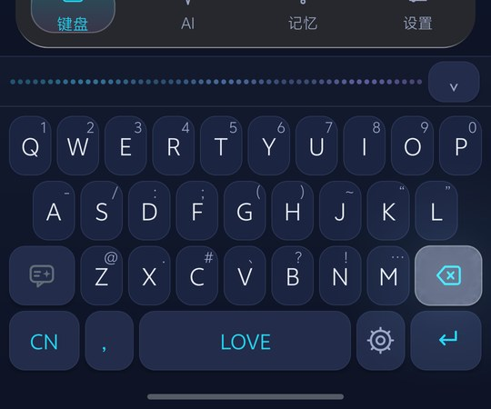
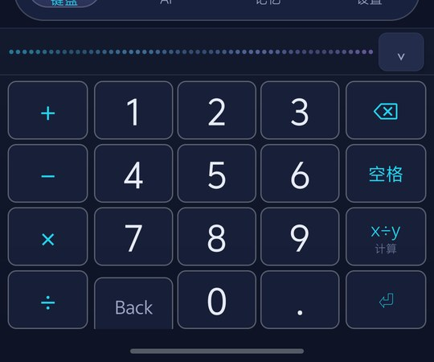
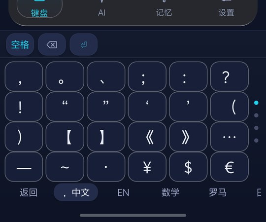

# Banzi · 半字

> An Android IME written on a single phone in pure Java with native Canvas: AI word association, a playable HTML design console, and a privacy mode.

-brightgreen)


**[⬇️ Download APK](https://github.com/uniwuyuan/banzi/releases/latest)** · **[🎮 Try the keyboard wireframe](https://uniwuyuan.github.io/banzi/)** · **[🎛️ Design console](https://uniwuyuan.github.io/banzi/design-console.html)** · **[📐 Design assets](design/)** · **[🧪 Engine research](docs/)**

---

## What this is

Not another reskinned keyboard:

- **Pure Java 8** — not a single line of Kotlin in the core (only third-party libs pull in `kotlin-stdlib`). Keyboard, candidate bar, animations and themes are all drawn on `Canvas`.
- **Built from scratch** — input method service, layout engine, pinyin engine, candidate ranking and word association are all original code.
- **HTML design console** — tweak colors, key height, key gap, corner radius, candidate bar height and full-page layout (JSON) live inside a WebView. What you see is what ships.
- **AI without the hand-waving** — association v4 and prefix recall ship with held-out evaluation data and reproducible scripts. No inflated claims.
- **Privacy you can switch off** — Stealth mode L1/L2 turns off disk writes and all cloud requests with one tap.

## Screenshots

| 26-key | Numeric page · 3×3 grid | Symbols |
|---|---|---|
|  |  |  |

## Why it's worth a star

1. **A design console you can play with** — click the keyboard wireframe right in the browser ([live demo](https://uniwuyuan.github.io/banzi/)) and watch key gap, height and radius change instantly. Most IME projects don't have this.
2. **Offline association engine v4** — candidate pool = evidence words ∪ personal frequency, with time decay and trigram scoring. Held-out `hit@5 9.69%` against a 2.84% baseline, with the full evaluation protocol and scripts open-sourced ([docs/ASSOC-V4.md](docs/ASSOC-V4.md), [ai/eval_assoc.py](ai/eval_assoc.py)).
3. **Prefix recall research** — 66.4% of word selections share a pinyin prefix with earlier input; 56.9% of records could save keystrokes ([docs/PHRASE-MEMORY-RESEARCH.md](docs/PHRASE-MEMORY-RESEARCH.md)).
4. **UI design assets** — 35 24×24 SVG icons, a design contract in JSON, and secondary-page specs you can lift straight into another project ([design/](design/)).
5. **Privacy engineering docs** — the L1 ("stop recording") / L2 ("stop reading + stop cloud") tiering is fully specified ([docs/PRIVACY-SPEC.md](docs/PRIVACY-SPEC.md)).
6. **Hand-drawn animation** — pulse bars, glassmorphism key surfaces and photon easter eggs, all written by hand in Canvas ([ui-reference/](ui-reference/)).

## What's open, what's not

This repository **deliberately open-sources only the AI and UI layers**:

| Open ✅ | Closed ❌ (APK only) |
|---|---|
| Design system, icons, design contract, playable wireframe | Pinyin engine, syllable tables, segmentation / sentence DP |
| Layout renderer reference, pulse bars, breathing animation | Dictionary and word-frequency data, user dictionary and association storage |
| AI evaluation scripts, research docs, privacy spec | Native ASR / JNI, build system, signing and release pipeline |
| Design console HTML (WebView frontend) | Input method service integration layer |

> Dictionaries and engines are long-term tuning work and data assets, and they're privacy-sensitive. Open-sourcing the UI and AI methodology is where the community value is.

## Layout

```
design/       Design system: SCHEMA contract, 35 SVG icons, theme seeds, HTML console
demo/         Playable keyboard wireframe (GitHub Pages static site)
docs/         Engine / association / privacy research notes
ai/           Offline evaluation scripts (association, prefix recall)
ui-reference/ UI reference implementation: layout renderer, pulse bars, breathing animation
release/      APK and checksums
images/       README screenshots
```

## Try it

1. **APK** — grab it from [Releases](https://github.com/uniwuyuan/banzi/releases/latest). Android 8.0+ / arm64. (The offline speech model downloads on first use when prompted.)
2. **No install needed** — open the [live demo](https://uniwuyuan.github.io/banzi/) and tap the numeric, operator or calc keys to play with the wireframe.
3. **See how the design is defined** — `design/SCHEMA.md` is the single JSON contract between the console and the IME.

## Permissions and privacy

| Permission | Used for | Can be disabled |
|---|---|---|
| Accessibility service | On-screen text extraction, WeChat replies, image recognition | ✅ Typing works without it |
| Notification access | Pulse bars, auto-filling verification codes | ✅ |
| Screen recording | Audio pulse, screenshot recognition | ✅ |
| Network | AI association / chat / speech recognition (bring your own key) | ✅ Fully off in Stealth L2 |

- Keystrokes are processed on-device by default and never uploaded.
- AI features require your own API key — no server-side key is bundled.
- Stealth mode L2: no disk writes, no history reads, no cloud requests.
- Full design: [docs/PRIVACY-SPEC.md](docs/PRIVACY-SPEC.md)

## Roadmap

- [ ] Export / import theme packs from the design console
- [ ] Open-source wireframes for the symbol and emoji pages
- [ ] Publish more algorithm replay data (association, prefix recall)
- [x] English README
- [ ] Screen-recording GIF

## Dependencies and credits

Kotlin stdlib, sherpa-onnx, onnxruntime (Apache-2.0), and others — see [NOTICE](NOTICE).

## License

Text and code in this repository are licensed under [Apache-2.0](LICENSE). **The Banzi core engine and dictionaries are not part of this repository and are not covered by this license**; the APK binary follows the terms on the Releases page.

---

<sub>If this project gave you an idea, a ⭐ is appreciated. Need something built — a custom enterprise IME, a minority-language keyboard, or a keyboard SDK integration? Open an issue.</sub>
