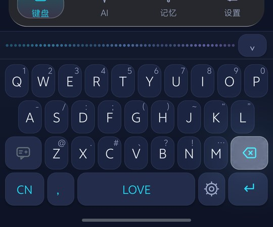
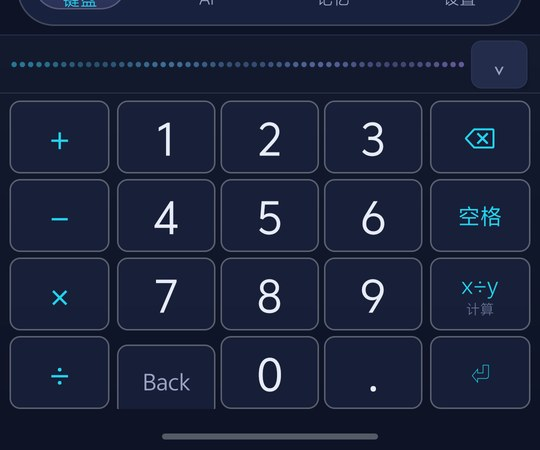
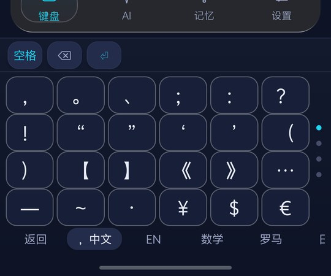

# 半字 · Banzi

> 一台手机、纯 Java、原生 Canvas 写出来的 Android 输入法：AI 联想 + 可玩 HTML 设计台 + 隐私模式。

-brightgreen)


**[⬇️ 下载 APK](https://github.com/uniwuyuan/banzi/releases/latest)** · **[🎮 在线试玩键盘线框](https://uniwuyuan.github.io/banzi/)** · **[🎛️ 在线设计台](https://uniwuyuan.github.io/banzi/design-console.html)** · **[📐 设计资料](design/)** · **[🧪 引擎研究](docs/)**

---

## 这是什么

不是又一个换皮输入法：

- **纯 Java 8**：核心代码没有一行 Kotlin（仅第三方库带 kotlin-stdlib），键盘/候选栏/动画/主题全部 `Canvas` 自绘
- **原生实现**：输入法服务、自绘布局引擎、拼音引擎、候选排序、联想，都是自己写的
- **HTML 设计台**：键盘的配色、键高、键距、圆角、候选栏高度、整页布局（JSON）都能在 WebView 里实时调，所见即所得
- **AI 但不玄学**：联想 v4 / 前缀召回都有 held-out 评测数据和可复现脚本，不吹效果
- **隐私可关**：隐匿模式 L1/L2，一键关闭落盘和云端请求

## 截图

| 26 键 | 数字页 · 九宫格 | 符号页 |
|---|---|---|
|  |  |  |

## 为什么值得 star

1. **可玩的设计台**：浏览器里直接点键盘线框（[在线 demo](https://uniwuyuan.github.io/banzi/)），键距/键高/圆角改一下立刻看到效果 —— 大部分输入法项目没有这个
2. **离线联想算法 v4**：候选池 = 证据词 ∪ 个人高频，时间衰减 + trigram，held-out `hit@5 9.69%`（基线 2.84%），评测协议与脚本全部开源（[docs/ASSOC-V4.md](docs/ASSOC-V4.md)、[ai/eval_assoc.py](ai/eval_assoc.py)）
3. **前缀召回研究**：66.4% 的选词与历史输入同拼音，56.9% 的记录可省按键（[docs/PHRASE-MEMORY-RESEARCH.md](docs/PHRASE-MEMORY-RESEARCH.md)）
4. **UI 设计资产**：35 个 24×24 SVG 图标 + 设计契约 JSON + 二级页规格，可直接挪到别的项目（[design/](design/)）
5. **隐私工程文档**：L1「只关记」/ L2「关读+关云」的分级设计（[docs/PRIVACY-SPEC.md](docs/PRIVACY-SPEC.md)）
6. **自绘动画**：律动条、玻璃拟态键面、光子彩蛋，全是 Canvas 手写（[ui-reference/](ui-reference/)）

## 开源范围

本仓库**有意只开源 AI 与 UI 部分**：

| 开源 ✅ | 闭源 ❌（仅发布 APK） |
|---|---|
| 设计系统、图标、设计契约、可玩线框 | 拼音引擎、音节表、分词/整句 DP |
| 布局渲染器参考实现、律动条、呼吸动画 | 词库/词频数据、用户词库与联想存储 |
| AI 评测脚本、研究文档、隐私规格 | 原生 ASR/JNI、构建系统、签名与发布链路 |
| 设计台 HTML（WebView 前端） | 输入法服务整合层 |

> 词库和引擎是长期调参与数据资产，也是隐私敏感部分；UI 和 AI 方法论开源对社区更有价值。

## 目录

```
design/       设计系统：SCHEMA 契约、35 个 SVG 图标、主题种子、HTML 设计台
demo/         可玩键盘线框（GitHub Pages 静态站）
docs/         引擎/联想/隐私 研究文档
ai/           离线评测脚本（联想、前缀召回）
ui-reference/ UI 参考实现：布局渲染器、律动条、呼吸动画
release/      APK 与校验和
images/       README 截图
```

## 体验方式

1. **APK**：到 [Releases](https://github.com/uniwuyuan/banzi/releases/latest) 下载，Android 8.0+ / arm64（离线语音模型需按提示下载）
2. **不装也能试**：打开 [在线 Demo](https://uniwuyuan.github.io/banzi/)，点数字/运算符/计算键就能玩键盘线框
3. **看设计怎么定**：`design/SCHEMA.md` 是设计台 ↔ 输入法的唯一 JSON 契约

## 权限与隐私

| 权限 | 用途 | 可以关吗 |
|---|---|---|
| 无障碍服务 | 读屏取词、微信回复、识图 | ✅ 不授权也能打字 |
| 通知使用权 | 律动条、验证码自动填入 | ✅ |
| 屏幕录制 | 音频律动、截屏识图 | ✅ |
| 网络 | AI 联想/对话/语音识别（填自己的 Key） | ✅ L2 隐匿模式全停 |

- 键盘输入默认只在本机处理，不上传
- AI 功能需要自己配置 API Key（不内置任何服务端 Key）
- 隐匿模式 L2：不落盘、不读历史、不发云端请求
- 详细设计见 [docs/PRIVACY-SPEC.md](docs/PRIVACY-SPEC.md)

## Roadmap

- [ ] 设计台导出/导入主题包
- [ ] 符号页/Emoji 页的开源线框补齐
- [ ] 更多算法回放数据（联想、前缀召回）公开
- [ ] 英文 README / 录屏 GIF

## 依赖与致谢

Kotlin stdlib、sherpa-onnx、onnxruntime（Apache-2.0）等，详见 [NOTICE](NOTICE)。

## License

本仓库内文本与代码采用 [Apache-2.0](LICENSE) 许可。**半字核心引擎与词库不在本仓库中，不随本许可证授权**；APK 二进制以 Release 页说明为准。

---

<sub>如果这个项目给了你灵感，点个 ⭐；有定制需求（企业输入法 / 小语种键盘 / 键盘 SDK）欢迎开 issue。</sub>
